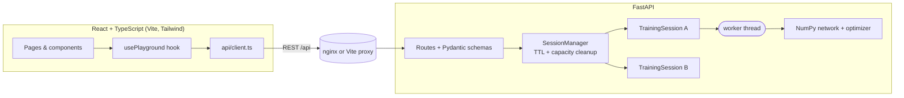

# AI Lab · Neural Network Playground

An interactive platform for learning how neural networks work by training real ones. **AI Lab** is the product shell (home page + feature registry); the **Neural Network Playground** is its first feature, with more labs planned.


Everything on screen comes from a real NumPy network training on the server: loss/accuracy curves, the decision boundary, the weights in the diagram, and the activations on each node. There is no mock data and no simulated progress.

> 📘 An interactive end-to-end walkthrough of the project lives in [`docs/project-report.html`](docs/project-report.html) (open it in a browser).

## Features

| Area | What you get |
|---|---|
| Datasets | XOR, two moons, circles, linearly separable, and a **custom** dataset drawn by clicking; configurable size, noise and seed |
| Designer | 0–5 hidden layers, 1–32 neurons each, ReLU/sigmoid/tanh, 4 initializers, SGD/Adam, learning rate, batch size, epochs, validation split, live parameter count, per-field validation and help |
| Network diagram | SVG built from the **actual weights**: sign → solid/dashed + colour, magnitude → thickness, node colour → activation, hover for bias/activation/weight |
| Decision boundary | Real prediction grid (56×56), contour at p = 0.5, hover confidence, drag-pan, wheel/keyboard zoom, legend |
| Training | Background-thread sessions, Pause / Resume / Reset, elapsed time, loss, accuracy, validation metrics, error reporting |
| Analytics | Train/val loss and accuracy, gradient norm, parameter norm, plus a pinnable baseline run for overlay comparisons |
| Learning Center | 14 topics with KaTeX formulas, variable glossary, live numbers from *your* experiment, activation explorer, gradient-descent toy, and a **real one-iteration trace** |
| Presets | XOR, linear, underfitting, overfitting, learning-rate, activation and optimizer comparisons (with variants) |
| Product shell | Responsive home page, dark/light theme, feature registry for future labs |

## Architecture



* One `TrainingSession` per experiment: own data split, network, optimizer, RNG, history, lock and worker thread. There is no global model.
* The worker updates parameters under the session lock, one mini-batch at a time, and checks a pause `Event` before every batch. Predictions copy a consistent snapshot under the same lock.
* The frontend polls `/status` every 250 ms while running; only when the epoch changes does it fetch incremental history (`?since=`), parameters and a grid prediction. Charts thin long series for *drawing only*; the stored data is untouched.

```
backend/app/    nn.py (network, losses, optimizers) · datasets.py · sessions.py · schemas.py · main.py
backend/tests/  27 numerical tests + 14 API tests
frontend/src/   api/ · hooks/ · lib/ · components/ · pages/ · test/
docs/           API.md · DEPLOY_AWS.md · project-report.html
scripts/        capture-screenshots.mjs (Playwright drives the real app)
```

## Run locally

**Prerequisites:** Python 3.11+ (tested 3.13), Node 20+ (tested 22), npm.

```bash
# 1. Backend  (http://localhost:8000, docs at /docs)
cd backend
python -m venv .venv && source .venv/bin/activate
pip install -r requirements-dev.txt
uvicorn app.main:app --reload --port 8000

# 2. Frontend (new terminal)  (http://localhost:5173)
cd frontend
npm install
npm run dev
```

The dev server proxies `/api` to `localhost:8000` (override with `VITE_API_PROXY`).

**Docker:** `docker compose up --build` → http://localhost:8080 (nginx serves the SPA and proxies `/api`).

Copy `.env.example` to `.env` to change limits. Never commit `.env`.

## Tests

```bash
cd backend && pytest -q                        # 41 tests
cd frontend && npm test && npm run typecheck   # 15 tests
```

Backend tests cover forward propagation vs a manual computation, **finite-difference gradient checking** (3 activations × 3 depths), SGD/Adam update rules, loss decrease, XOR needing a hidden layer, stable sigmoid/BCE at extreme inputs, output shapes, and the API: parameters really change during training, pause truly freezes the epoch counter, reset restores seeded initial weights, independent sessions, validation/404/409 errors, dry-run trace leaves the model untouched, and session cleanup.

## The mathematics

Samples are rows; layer *l* computes `z = a·W + b`, `a = f(z)`; the output layer is one sigmoid neuron.

**Loss (binary cross-entropy)**, computed from logits for stability:

```
L = 1/m · Σ [ max(z,0) − z·y + ln(1 + e^(−|z|)) ]
```

**Backpropagation.** With sigmoid output + BCE the output error simplifies to `δ_L = (p − y)/m`. For earlier layers:

```
δ_l = (δ_{l+1} · W_{l+1}ᵀ) ⊙ f′(z_l)        ∂L/∂W_l = a_{l−1}ᵀ · δ_l        ∂L/∂b_l = Σ_rows δ_l
```

Derivatives: `σ′ = a(1−a)`, `tanh′ = 1−a²`, `ReLU′ = 1[z>0]`.

**Optimizers.** SGD: `θ ← θ − η g`. Adam: `m ← β₁m + (1−β₁)g`, `v ← β₂v + (1−β₂)g²`, `θ ← θ − η · m̂ / (√v̂ + ε)` with bias correction (β₁ = 0.9, β₂ = 0.999, ε = 1e-8).

**Initialization.** Xavier: U(±√(6/(n_in+n_out))); He: N(0, 2/n_in); small normal σ = 0.1; zeros (demonstrates the symmetry problem). Biases start at 0.

**Numerical care.** Sigmoid uses `exp(−|z|)`, the loss never exponentiates a large positive number, a probability-form BCE clips to [1e-7, 1−1e-7], and a run whose loss/weights become NaN/Inf is stopped and reported as *failed* with a helpful message.

## API

Interactive docs: `http://localhost:8000/docs`. Summary in [`docs/API.md`](docs/API.md).

**Documented deviations from the suggested contract:** `POST /api/models` creates a *ready* session (so the diagram can show the real initial weights before training); `POST /api/training/start` accepts either that `session_id` or an inline dataset + config; added `DELETE /api/training/{id}`, `GET …/history?since=`, `GET …/iteration-trace`, and `predict` accepts a server-built `grid` as well as explicit `points`.

## Example experiments

Use the presets in the UI. Observations below come from this implementation, but results depend on seed, data and hyper-parameters.

| Preset | What to look for |
|---|---|
| XOR | Hidden units let the boundary form four regions; with 0 hidden layers accuracy stalls well below 100 % |
| Linear | Boundary is always a straight line (3 parameters) |
| Underfitting | One hidden neuron on circles: both losses stay high |
| Overfitting | 50 noisy points, 3×32 units: training loss can fall while validation loss flattens/rises (noisy; seed dependent) |
| Learning rate | 0.005 crawls, 0.3 converges, 8 oscillates or diverges; pin runs to overlay |
| Activation / Optimizer | Same data and seed, different activation or optimizer; pin and compare |

## Deploying to AWS (planned)

The app is container-ready. The quickest route is the CloudFormation template in [`infra/aws/nn-playground.yaml`](infra/aws/nn-playground.yaml): one stack creates the server, deploys the app and reports success only when it is healthy. See [`docs/DEPLOY_AWS.md`](docs/DEPLOY_AWS.md) for steps and alternatives (App Runner, ECS Fargate, S3/CloudFront).

## Limitations and future work

* Sessions live in process memory: run **one** backend worker/instance. Scaling out needs sticky sessions or an external store (Redis).
* Training is intentionally small (≤ 2000 points, ≤ 2000 epochs, 2 input features). No auth or rate limiting yet.
* Polling rather than WebSocket/SSE streaming.
* Optional PyTorch comparison extension was **not** implemented.
* No end-to-end tests in CI (the Playwright script is run manually).
* Docker images were not built in the authoring environment; compose config is validated only.
* Roadmap labs on the home page (loss landscape, convolution, attention) are not built yet.

## License

MIT, see [LICENSE](LICENSE).
