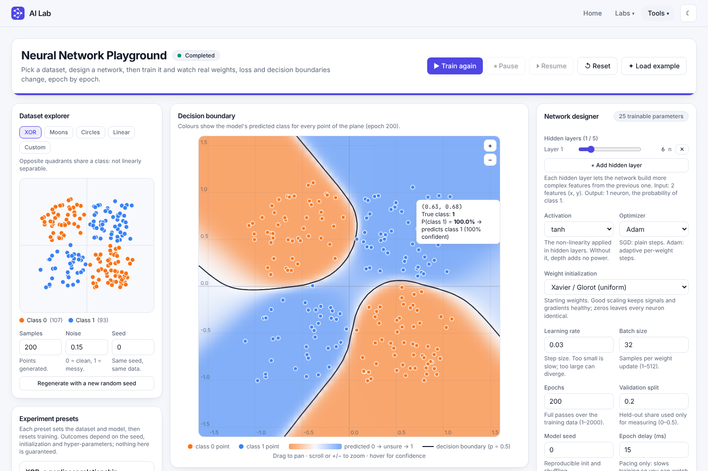
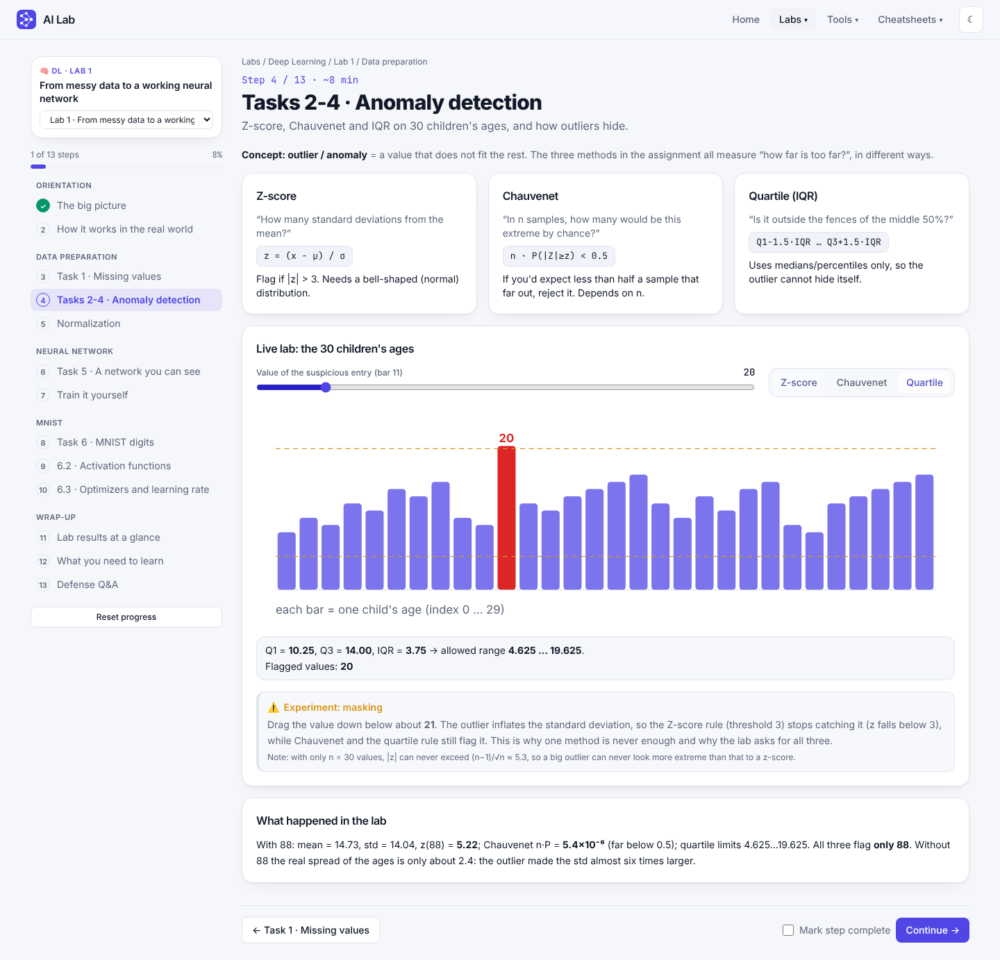

# AI Lab

A multi-domain platform of **guided labs** and **interactive tools** covering **Machine Learning, Deep Learning and Natural Language Processing**. Every project is its own self-contained lab or tool and belongs to one domain. Today it ships:

* **Lab 1 · From messy data to a working neural network**: 13 step-by-step lessons with 9 live demos (missing values, three anomaly methods, scaling, a from-scratch network, MNIST, activations, optimizers, results, checklist and Q&A).
* **Neural Network Playground**: design and train networks on a NumPy/FastAPI back end and watch the weights, loss and decision boundary change. It covers the course material on activations and losses, optimizers, regularisation, dropout, batch norm, early stopping, evaluation metrics and cross-validation.
* **Convolution Explorer** and **Recurrent Cell Explorer**: browser-only tools for CNNs (kernels, stride, padding, pooling, receptive field, the MNIST CNN's shapes and parameters) and for SimpleRNN, LSTM and GRU cells (state and gates step by step).
* **Cheatsheets**: searchable, printable quick references. The **Neural Network cheatsheet** has 14 sections (blocks, activations, output layers, losses, optimizers, generalisation, validation, metrics, CNN, RNN, text, Keras code, calculators, debugging). Machine Learning and NLP sheets are listed as planned.

New labs, tools and cheatsheets plug in through registries (see *Adding a lab*). Navigation: **Home · Labs ▾ · Tools ▾ · Cheatsheets ▾**, with all menus grouped by domain.



Everything on screen comes from a real NumPy network training on the server: loss/accuracy curves, the decision boundary, the weights in the diagram, and the activations on each node. There is no mock data and no simulated progress.

> 📘 An interactive end-to-end walkthrough of the project lives in [`docs/project-report.html`](docs/project-report.html) (open it in a browser).

## Labs platform

| Piece | What it does |
|---|---|
| Domains (`labs/domains.ts`) | ML, DL and NLP; every lab and tool declares one. Menus, filters and the home page group by domain |
| Home | Platform overview, *Explore by domain* tiles, *Available now*, *Coming next* |
| Labs menu + `/labs` index | Lists every lab grouped by domain; filter by domain (`?domain=ml`) and status; per-lab progress |
| Tools menu + `/tools` index | Stand-alone apps (Playground, Convolution Explorer, Recurrent Cell Explorer), grouped by domain |
| Cheatsheets menu + `/cheatsheets` | Reference sheets grouped by domain; each sheet has a section list, search over titles and keywords, and Print / save as PDF |
| Lab shell `/labs/:labId/:stepId` | Sidebar stepper grouped by topic, lab switcher, progress %, previous/next, “mark complete”, mobile drawer |
| Progress | Saved per lab in the browser; resumes at the last step |
| Lab 1 | Ported from the uploaded *Lab1_Visual_Guide.html*; every demo computes for real and the quoted numbers are asserted by unit tests |



**Adding a lab:** create `frontend/src/labs/<name>/index.ts` exporting a `Lab` (id, number, **domain**, title, steps with lazy React components), then add it to `LABS` in `frontend/src/labs/registry.ts` (a planned placeholder is simply replaced). The menus, domain filters, index, home page, routes, stepper and progress tracking pick it up. **Adding a tool:** add an entry to `TOOLS` in `src/lib/features.ts` (with its domain) and a route in `App.tsx`. **Adding a cheatsheet:** create a file exporting a `Cheatsheet` (sections with `title`, search `keywords` and a `render()`), then list it in `SHEETS` in `frontend/src/cheatsheets/registry.ts`; the menu, index and routes pick it up (a `planned` entry is replaced). **Adding a domain:** add it to `DOMAINS` in `labs/domains.ts`. Shared demo primitives live in `labs/ui.tsx`.

> **Correction made while porting Lab 1.** The original guide said the Z-score rule (threshold 3) stops catching the suspicious age at about 30–40. Measured on the 30 ages it only stops below ≈ 21 (z = 4.3 at 30, 4.8 at 40). The lab text, the Q&A answer and a regression test now reflect the real behaviour.

## Playground features

| Area | What you get |
|---|---|
| Datasets | XOR, two moons, circles, linearly separable, and a **custom** dataset drawn by clicking; configurable size, noise and seed |
| Designer | 0–5 hidden layers, 1–32 neurons each; 8 activations (ReLU, Leaky ReLU, ELU, SELU, sigmoid, tanh, softplus, SiLU); 4 initializers; 8 optimizers (SGD, momentum, Nesterov, Adagrad, RMSprop, Adadelta, Adam, Nadam); 3 losses (BCE, MSE, hinge); learning rate, batch size, epochs, validation split, live parameter count, per-field validation and help |
| Regularisation | L1 and L2 penalties, dropout, batch normalisation, early stopping with patience and best-weights restore |
| Evaluation | Confusion matrix, accuracy, precision, recall, F1, ROC curve and AUC with an adjustable threshold, on train or validation data |
| Cross-validation | Hold-out, k-fold, stratified k-fold, shuffle split, time series split, leave-one-out; one fresh network per fold, mean ± std |
| Diagnosis | Reads your curves and says whether the run looks under-fitted, over-fitted, unstable or fine, and what to change |
| Network diagram | SVG built from the **actual weights**: sign → solid/dashed + colour, magnitude → thickness, node colour → activation, hover for bias/activation/weight |
| Decision boundary | Real prediction grid (56×56), contour at p = 0.5, hover confidence, drag-pan, wheel/keyboard zoom, legend |
| Training | Background-thread sessions, Pause / Resume / Reset, elapsed time, loss, accuracy, validation metrics, error reporting |
| Analytics | Train/val loss and accuracy, gradient norm, parameter norm, plus a pinnable baseline run for overlay comparisons |
| Learning Center | Topics with KaTeX formulas, variable glossary, live numbers from *your* experiment, activation explorer, gradient-descent toy, and a **real one-iteration trace** |
| Presets | XOR, linear, underfitting, overfitting, learning-rate, activation and optimizer comparisons (with variants) |
| Product shell | Responsive home page, dark/light theme, feature registry for future labs |

## Architecture


* One `TrainingSession` per experiment: own data split, network, optimizer, RNG, history, lock and worker thread. There is no global model.
* The worker updates parameters under the session lock, one mini-batch at a time, and checks a pause `Event` before every batch. Predictions copy a consistent snapshot under the same lock.
* The frontend polls `/status` every 250 ms while running; only when the epoch changes does it fetch incremental history (`?since=`), parameters and a grid prediction. Charts thin long series for *drawing only*; the stored data is untouched.

```
backend/app/    nn.py (network, losses, optimizers) · datasets.py · sessions.py · schemas.py · main.py
backend/tests/  numerical, metrics/validation, API and PyTorch cross-check tests
frontend/src/   api/ · hooks/ · lib/ · components/ · pages/ · explorers/ · cheatsheets/ · test/
frontend/src/labs/  registry.ts · progress.ts · ui.tsx · lab1/ (math, data, 13 steps)
infra/aws/      nn-playground.yaml (CloudFormation)
docs/           API.md · DEPLOY_AWS.md · project-report.html
scripts/        capture-*.mjs (Playwright drives the real app) · e2e_flow.py · make_rnn_fixtures.py
```

## Run locally

**Prerequisites:** Python 3.11+ (tested 3.13), Node 20+ (tested 22), npm.

```bash
# 1. Backend  (http://localhost:8000, docs at /docs)
cd backend
python -m venv .venv && source .venv/bin/activate
pip install -r requirements-dev.txt
uvicorn app.main:app --reload --port 8000

# 2. Frontend (new terminal)  (http://localhost:5173)
cd frontend
npm install
npm run dev
```

The dev server proxies `/api` to `localhost:8000` (override with `VITE_API_PROXY`). **The Labs need no backend**; only the Playground does.

**Docker:** `docker compose up --build` → http://localhost:8080 (nginx serves the SPA and proxies `/api`).

Copy `.env.example` to `.env` to change limits. Never commit `.env`.

## Tests

```bash
cd backend && pytest -q                        # 154 tests (196 with torch installed: PyTorch cross-checks)
cd frontend && npm test && npm run typecheck   # 120 tests (Lab 1 maths, registries, navigation, optimizers/activations/losses, cheatsheets, explorers vs NumPy/PyTorch values)
```

Backend tests cover forward propagation vs a manual computation, **finite-difference gradient checking** (3 activations × 3 depths), SGD/Adam update rules, loss decrease, XOR needing a hidden layer, stable sigmoid/BCE at extreme inputs, output shapes, and the API: parameters really change during training, pause truly freezes the epoch counter, reset restores seeded initial weights, independent sessions, validation/404/409 errors, dry-run trace leaves the model untouched, and session cleanup.

### Verification against PyTorch

`backend/tests/test_against_pytorch.py` runs the same weights through the NumPy network and through PyTorch autograd. It checks the loss, every gradient (each activation and depth, dropout with identical masks, batch norm) and optimizer trajectories against `torch.optim`. `scripts/make_rnn_fixtures.py` writes PyTorch RNN and LSTM outputs that the frontend tests must reproduce; the GRU uses the lecture's formula and is checked by hand against it. Convolution and pooling exercises are compared with NumPy results. Install `torch` (CPU wheel is enough) to run the PyTorch tests; without torch they are skipped.

## End-to-end flow

The full path from a click to the NumPy maths and back, with a sequence diagram and an automated check (`python scripts/e2e_flow.py` against a running backend, 20 steps): see [`docs/END_TO_END.md`](docs/END_TO_END.md).

## The mathematics

Samples are rows; layer *l* computes `z = a·W + b`, `a = f(z)`; the output layer is one sigmoid neuron.

**Loss (binary cross-entropy)**, computed from logits for stability:

```
L = 1/m · Σ [ max(z,0) − z·y + ln(1 + e^(−|z|)) ]
```

**Backpropagation.** With sigmoid output + BCE the output error simplifies to `δ_L = (p − y)/m`. For earlier layers:

```
δ_l = (δ_{l+1} · W_{l+1}ᵀ) ⊙ f′(z_l)        ∂L/∂W_l = a_{l−1}ᵀ · δ_l        ∂L/∂b_l = Σ_rows δ_l
```

Derivatives: `σ′ = a(1−a)`, `tanh′ = 1−a²`, `ReLU′ = 1[z>0]`.

**Optimizers.** SGD: `θ ← θ − η g`. Adam: `m ← β₁m + (1−β₁)g`, `v ← β₂v + (1−β₂)g²`, `θ ← θ − η · m̂ / (√v̂ + ε)` with bias correction (β₁ = 0.9, β₂ = 0.999, ε = 1e-8).

**Initialization.** Xavier: U(±√(6/(n_in+n_out))); He: N(0, 2/n_in); small normal σ = 0.1; zeros (demonstrates the symmetry problem). Biases start at 0.

**Numerical care.** Sigmoid uses `exp(−|z|)`, the loss never exponentiates a large positive number, a probability-form BCE clips to [1e-7, 1−1e-7], and a run whose loss/weights become NaN/Inf is stopped and reported as *failed* with a helpful message.

## API

Interactive docs: `http://localhost:8000/docs`. Summary in [`docs/API.md`](docs/API.md).

**Documented deviations from the suggested contract:** `POST /api/models` creates a *ready* session (so the diagram can show the real initial weights before training); `POST /api/training/start` accepts either that `session_id` or an inline dataset + config; added `DELETE /api/training/{id}`, `GET …/history?since=`, `GET …/iteration-trace`, and `predict` accepts a server-built `grid` as well as explicit `points`.

## Example experiments

Use the presets in the UI. Observations below come from this implementation, but results depend on seed, data and hyper-parameters.

| Preset | What to look for |
|---|---|
| XOR | Hidden units let the boundary form four regions; with 0 hidden layers accuracy stalls well below 100 % |
| Linear | Boundary is always a straight line (3 parameters) |
| Underfitting | One hidden neuron on circles: both losses stay high |
| Overfitting | 50 noisy points, 3×32 units: training loss can fall while validation loss flattens/rises (noisy; seed dependent) |
| Learning rate | 0.005 crawls, 0.3 converges, 8 oscillates or diverges; pin runs to overlay |
| Activation / Optimizer | Same data and seed, different activation or optimizer; pin and compare |

## Deploying to AWS (planned)

The app is container-ready. The quickest route is the CloudFormation template in [`infra/aws/nn-playground.yaml`](infra/aws/nn-playground.yaml): one stack creates the server, deploys the app and reports success only when it is healthy. See [`docs/DEPLOY_AWS.md`](docs/DEPLOY_AWS.md) for steps and alternatives (App Runner, ECS Fargate, S3/CloudFront).

## Limitations and future work

* Finished runs are stored in SQLite (`DB_PATH`, see `docs/API.md`), which suits one backend instance; there are no user accounts, so every visitor sees the same "My runs".
* Sessions live in process memory: run **one** backend worker/instance. Scaling out needs sticky sessions or an external store (Redis).
* Training is intentionally small (≤ 2000 points, ≤ 2000 epochs, 2 input features). No auth or rate limiting yet.
* Polling rather than WebSocket/SSE streaming.
* PyTorch is used only to cross-check the maths in the tests; there is no PyTorch training mode in the app.
* The Playground is a 2-D binary classifier. CNNs and RNNs need images and sequences, so they are shown in the two explorers (fixed weights, real computation) rather than trained.
* The Machine Learning and NLP cheatsheets are placeholders marked *Planned*.
* No end-to-end tests in CI (the Playwright scripts `scripts/capture-labs.mjs`, `scripts/capture-cheatsheets.mjs` and `scripts/capture-screenshots.mjs` are run manually).
* Docker images were not built in the authoring environment; compose config is validated only.
* Labs 2-4 on the home page and Labs index (CNN, attention, loss landscapes) are placeholders marked *Planned*.
* Lab progress is stored per browser only (no accounts).

## License

MIT, see [LICENSE](LICENSE).
