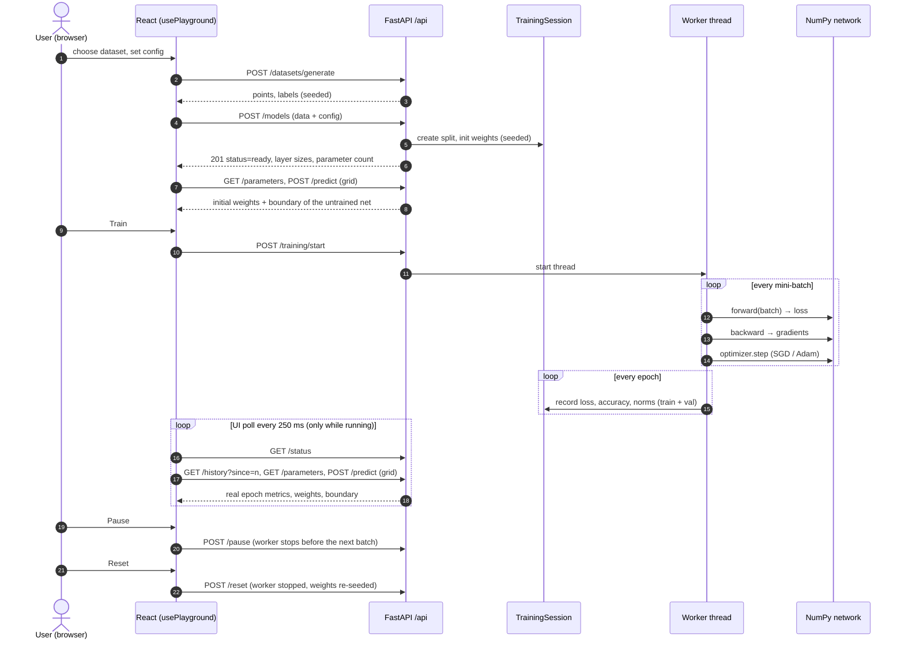

# End-to-end flow

This is the full path a user's action takes, from a click in the browser to NumPy arithmetic and back. It is also what `scripts/e2e_flow.py` checks automatically.

## The flow in one picture



## Each stage

| # | Stage | Where | What is real |
|---|---|---|---|
| 1 | Dataset | `app/datasets.py` | Seeded generators for XOR, moons, circles, linear |
| 2 | Session creation | `app/sessions.py` `TrainingSession` | Train/val split by seeded shuffle; weights by Xavier, He, small-normal or zeros |
| 3 | Start | `SessionManager` + worker thread | One thread per session; independent RNGs |
| 4 | Mini-batch iteration | `app/nn.py` | Vectorised forward, BCE from logits, backprop with the chain rule, SGD or Adam |
| 5 | Epoch record | `_record_epoch` | Train/val loss and accuracy, gradient norm, parameter norm, elapsed time; NaN/Inf stops the run as *failed* |
| 6 | Polling | `usePlayground` (React) | Only the epoch changes trigger history, parameter and boundary fetches |
| 7 | Pause / resume | `threading.Event` | Checked before every batch, so the model is frozen between batches |
| 8 | Predict | `/predict` | Points or a server-built grid; the UI draws the decision boundary from the same numbers |
| 9 | Dry-run trace | `/iteration-trace` | One sample through forward and backward; the model is not changed |
| 10 | Reset / cleanup | `/reset`, `/DELETE`, TTL janitor | Re-seeded weights; idle sessions removed after the TTL |
| 11 | Evaluation | `app/metrics.py`, `/evaluation` | Confusion matrix, precision/recall/F1, ROC and AUC at an adjustable threshold |
| 12 | Regularisation and early stopping | `app/nn.py`, `app/sessions.py` | L1/L2, inverted dropout, batch norm, patience with best-weights restore |
| 13 | Cross-validation | `app/cv.py`, `/cross-validation` | A fresh network per fold: hold-out, k-fold, stratified, shuffle split, time series, leave-one-out |

## Run it yourself

```bash
cd backend && uvicorn app.main:app --port 8000     # terminal 1
python scripts/e2e_flow.py                         # terminal 2 (exit code 0 = all pass)
```

The browser side is covered by `scripts/capture-screenshots.mjs` (train, pause, resume, reset, presets, mobile, backend-down), `scripts/capture-labs.mjs` and `scripts/capture-cheatsheets.mjs` (cheatsheets menu, search, print, both explorers, phone-width layout).

## Captured run

Output of `scripts/e2e_flow.py` against the live backend (values differ from run to run only if you change the seeds):

```
[PASS] 1 health — active_sessions=0
[PASS] 2 dataset catalogue — xor, moons, circles, linear, custom
[PASS] 3 dataset generated — 200 points, 100 class-1, same seed -> identical
[PASS] 4 model created — status=ready, layers=[2, 8, 1]
[PASS] 5 parameter count — 33 = 33
[PASS] 6 initial parameters readable — 2x8 hidden weights
[PASS] 7 pause freezes training — HTTP 200, epoch 35 -> 35
[PASS] 8 resume
[PASS] 9 training completed — epoch 150/150, elapsed 1.73s
[PASS] 10 loss decreased — train loss 0.6885 -> 0.0019
[PASS] 11 accuracy — train 100.0%, val 97.5%
[PASS] 12 incremental history
[PASS] 13 weights updated by training
[PASS] 14 predict points — P(class1) at (0.9,0.9)=1.000, at (-0.9,0.9)=0.000
[PASS] 15 predict grid — 30x30 = 900 values
[PASS] 16 iteration trace is a dry run — loss 0.0000, sample 0, model unchanged
[PASS] 17 reset — weights identical to seeded initialisation
[PASS] 18 unknown session -> 404
[PASS] 19 invalid config -> 422
[PASS] 20 evaluation: confusion matrix adds up — n=40, accuracy=0.975, F1=0.978, AUC=1.000
[PASS] 21 raising the threshold cannot add positives
[PASS] 22 advanced config trains — epochs run=86/300, best_epoch=78, stopped_early=True
[PASS] 23 batch-norm parameters exposed
[PASS] 24 early stopping without validation data -> 422
[PASS] 25 cross-validation returns one result per fold — mean val accuracy 1.000 ± 0.000
[PASS] 26 delete session

26/26 steps passed
```

Note on step 7: with no pacing, 150 epochs on 160 points finish in well under a second, so the script uses `epoch_delay_ms` to make the pause observable. The API correctly returns 409 if you try to pause a completed run.
